# 美国七大电力市场（ISO/RTO）运行周报（2026-11-01 至 2026-11-07）

> **报告生成日（北京时间）**：2026-11-09 | **完整复盘周（美国运行日）**：`2026-11-01`（周日）至 `2026-11-07`（周六） | **环比基期**：`2026-10-25` 至 `2026-10-31`
> *注：周一北京时间下午生成时，美国周六已完成全天 RT 结算；峰时（On-Peak）统一按当地 HE8–23 口径测算。*

## 一、 本周全美电力市场核心摘要

- **价格格局**：本周全美最高 RT 均价出现在 **PJM**（73.5 $/MWh），最低为 **SPP**（21.1 $/MWh）。
- **最大波动区**：**PJM** 实时均价环比变动 **+98.5%**。
- **负电价频次**：本周出现实时负电价的地区包括 CAISO(1h)、ERCOT(12h)、SPP(13h)。
- **DART 系统性偏差**：本周日均 |DA-RT| ≥ 5 $/MWh 的市场：ERCOT(+5.0)、PJM(-15.3)、SPP(+5.2)。

## 二、 跨区周度核心指标总览

| ISO (主枢纽) | 本周RT均价 ($/MWh) | RT周环比 | 本周DA均价 | Peak / Off-Peak (RT) | DART (DA-RT) | 负电价小时 | 周均负荷 (GW) | 负荷环比 | 负荷预测偏差 | 新能源占比 |
| :--- | :---: | :---: | :---: | :---: | :---: | :---: | :---: | :---: | :---: | :---: |
| **CAISO** (SP15) | 43.3 | -5.5% | 41.7 | 36.8 / 56.0 | -1.6 | 1 | 22.0 | +4.1% | +0.4% | — |
| **ERCOT** (North) | 29.2 | -41.3% | 34.3 | 29.1 / 29.6 | +5.0 | 12 | 52.5 | +1.0% | +0.2% | — |
| **PJM** (Western) | 73.5 | +98.5% | 58.4 | 77.0 / 66.8 | -15.3 | 0 | 85.2 | +7.2% | +0.1% | — |
| **MISO** (Indiana) | 35.0 | -21.2% | 40.0 | 37.0 / 31.1 | +4.9 | 0 | 71.4 | +5.8% | +0.5% | — |
| **NYISO** (Zone J(NYC)) | 36.3 | +9.9% | 36.7 | 39.1 / 30.8 | +0.4 | 0 | 15.0 | +8.0% | +2.4% | — |
| **ISO-NE** (Mass Hub) | 42.1 | +27.0% | 39.8 | 46.8 / 32.8 | -2.3 | 0 | 11.5 | +12.3% | +0.0% | — |
| **SPP** (North) | 21.1 | -43.9% | 26.1 | 22.9 / 17.5 | +5.2 | 13 | 33.5 | +4.8% | +0.0% | — |

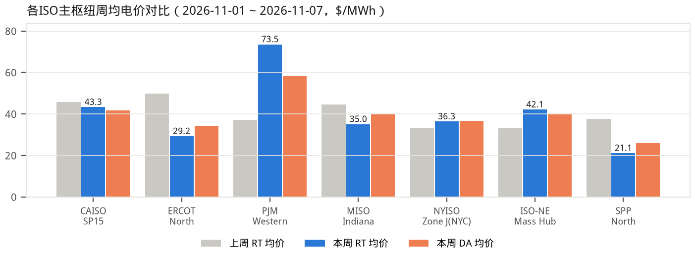
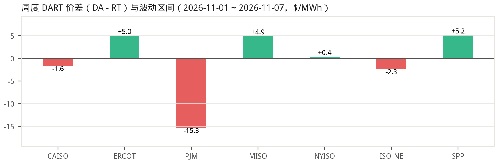
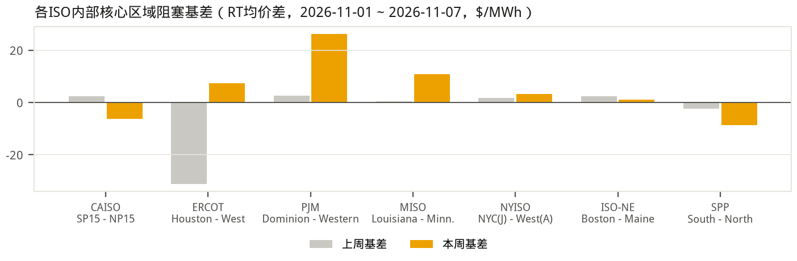
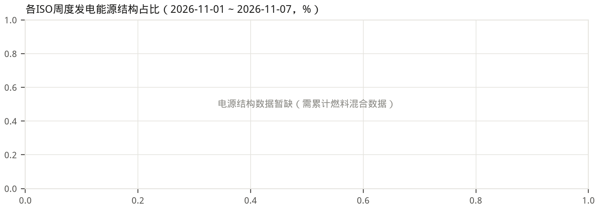

## 三、 空间阻塞基差与燃料基准

| ISO | 监测基差对 | 本周均价差 ($/MWh) | 上周均价差 | 周变化 ($/MWh) | 解读 |
| :--- | :--- | :---: | :---: | :---: | :--- |
| **CAISO** | SP15 - NP15 | -6.34 | +2.52 | -8.86 | 阻塞显著扩大 |
| **ERCOT** | Houston - West | +7.48 | -31.16 | +38.64 | 阻塞显著扩大 |
| **PJM** | Dominion - Western | +26.28 | +2.57 | +23.71 | 阻塞显著扩大 |
| **MISO** | Louisiana - Minn. | +10.83 | +0.58 | +10.25 | 阻塞显著扩大 |
| **NYISO** | NYC(J) - West(A) | +3.37 | +1.72 | +1.65 | 基差平稳 |
| **ISO-NE** | Boston - Maine | +1.05 | +2.50 | -1.45 | 基差平稳 |
| **SPP** | South - North | -8.58 | -2.43 | -6.15 | 阻塞显著扩大 |

## 四、 周初开盘前瞻（周日 & 周一日前市场 DA）

| ISO (主枢纽) | 周日 DA 均价 | 周一 DA 均价 | 周一 vs 上周DA均值 | 周一预测峰值负荷 (GW) |
| :--- | :---: | :---: | :---: | :---: |
| **CAISO** (SP15) | 35.8 | 47.4 | +13.8% | 29.9 |
| **ERCOT** (North) | 39.5 | 44.2 | +28.9% | 53.8 |
| **PJM** (Western) | 42.5 | 56.8 | -2.7% | 96.4 |
| **MISO** (Indiana) | 27.3 | 36.0 | -10.0% | 78.2 |
| **NYISO** (Zone J(NYC)) | 29.8 | 36.9 | +0.5% | 17.9 |
| **ISO-NE** (Mass Hub) | 38.8 | 41.6 | +4.4% | 14.9 |
| **SPP** (North) | 29.9 | 24.7 | -5.3% | 36.0 |

## 五、 七大 ISO 分区详述（168小时走势）

### CAISO（加州独立系统运营商）

- **主力枢纽 (SP15)**：本周 RT 均价 **43.28 $/MWh**（环比 -5.5%），峰值 **90.20**（2026-11-06 HE6），谷值 **-1.18**（2026-11-02 HE13）。
- **负荷与预测**：本周日均负荷 **22035 MW**（最高 **27684 MW**），周环比 **+4.1%**；负荷预测平均偏差 **+81 MW**（+0.4%）。
- **辅助服务周均价（$/MW·h）**：上调频 DA 2.98；下调频 DA 2.98；旋转/同步备用 DA 0.69；非旋转备用 DA 0.65。

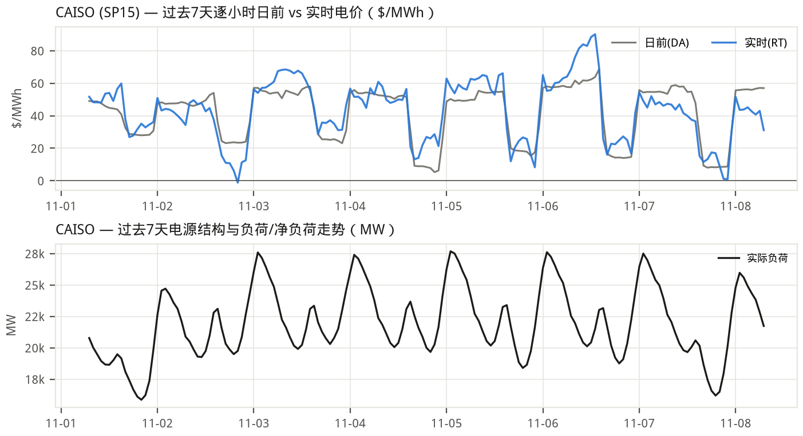

### ERCOT（德州电力可靠性委员会）

- **主力枢纽 (North)**：本周 RT 均价 **29.25 $/MWh**（环比 -41.3%），峰值 **165.42**（2026-11-03 HE19），谷值 **-13.48**（2026-11-03 HE13）。
- **负荷与预测**：本周日均负荷 **52533 MW**（最高 **65881 MW**），周环比 **+1.0%**；负荷预测平均偏差 **+106 MW**（+0.2%）。
- **辅助服务周均价（$/MW·h）**：上调频 DA 1.35；下调频 DA 1.01；响应备用(RRS) DA 0.88；紧急备用(ECRS) DA 1.30。

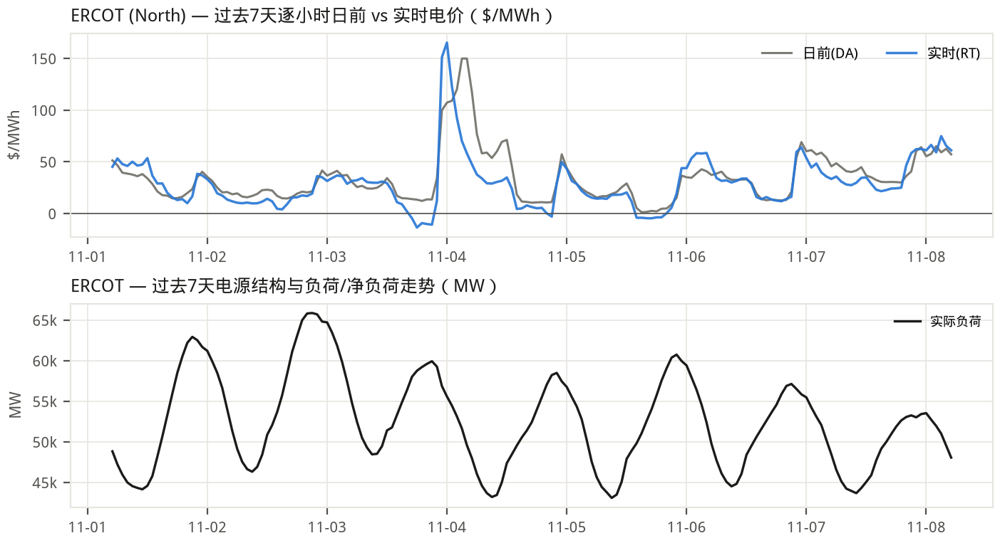

### PJM（PJM 互联）

- **主力枢纽 (Western)**：本周 RT 均价 **73.52 $/MWh**（环比 +98.5%），峰值 **508.09**（2026-11-01 HE1），谷值 **16.90**（2026-11-05 HE2）。
- **负荷与预测**：本周日均负荷 **85195 MW**（最高 **97795 MW**），周环比 **+7.2%**；负荷预测平均偏差 **+89 MW**（+0.1%）。
- **辅助服务周均价（$/MW·h）**：旋转/同步备用 DA 3.35；30分钟备用 DA 0.00；Primary Reserve DA 1.86。

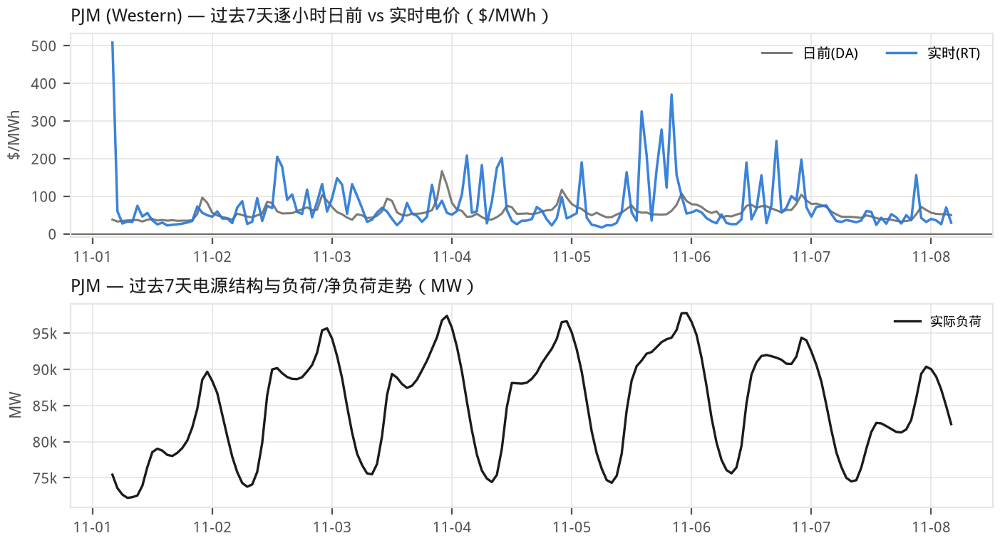

### MISO（中部大陆独立系统运营商）

- **主力枢纽 (Indiana)**：本周 RT 均价 **35.04 $/MWh**（环比 -21.2%），峰值 **88.69**（2026-11-01 HE17），谷值 **15.29**（2026-11-05 HE10）。
- **负荷与预测**：本周日均负荷 **71441 MW**（最高 **82036 MW**），周环比 **+5.8%**；负荷预测平均偏差 **+382 MW**（+0.5%）。
- **辅助服务周均价（$/MW·h）**：调频 DA 19.50；旋转/同步备用 DA 2.75；Supplemental Reserve DA 0.37。

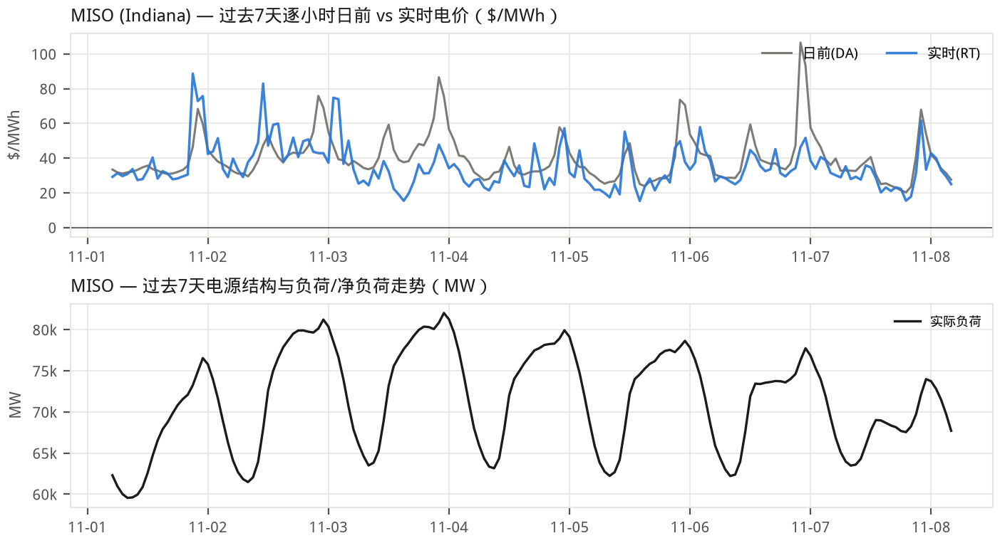

### NYISO（纽约独立系统运营商）

- **主力枢纽 (Zone J(NYC))**：本周 RT 均价 **36.33 $/MWh**（环比 +9.9%），峰值 **81.57**（2026-11-02 HE18），谷值 **21.01**（2026-11-01 HE13）。
- **负荷与预测**：本周日均负荷 **14969 MW**（最高 **18469 MW**），周环比 **+8.0%**；负荷预测平均偏差 **+350 MW**（+2.4%）。
- **辅助服务周均价（$/MW·h）**：调频 DA 14.31；旋转/同步备用 DA 7.94；非旋转备用 DA 7.78；30分钟备用 DA 7.62。

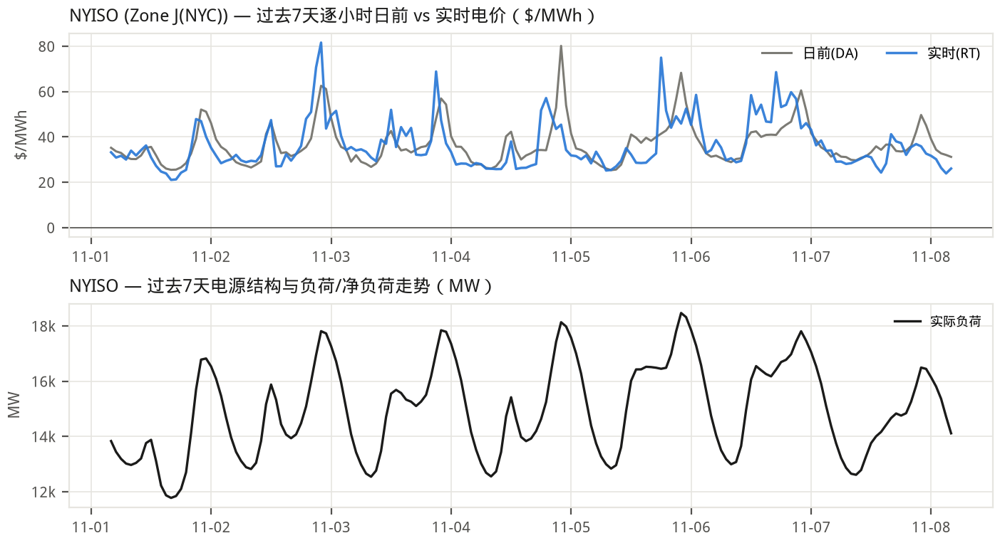

### ISO-NE（新英格兰独立系统运营商）

- **主力枢纽 (Mass Hub)**：本周 RT 均价 **42.10 $/MWh**（环比 +27.0%），峰值 **139.09**（2026-11-06 HE14），谷值 **6.79**（2026-11-01 HE13）。
- **负荷与预测**：本周日均负荷 **11496 MW**（最高 **14796 MW**），周环比 **+12.3%**；负荷预测平均偏差 **+1 MW**（+0.0%）。
- **辅助服务周均价（$/MW·h）**：旋转/同步备用 DA — / RT 0.28；10分钟备用(TMR) DA — / RT 0.00；Total Reserve Clearing Price DA — / RT 0.00。

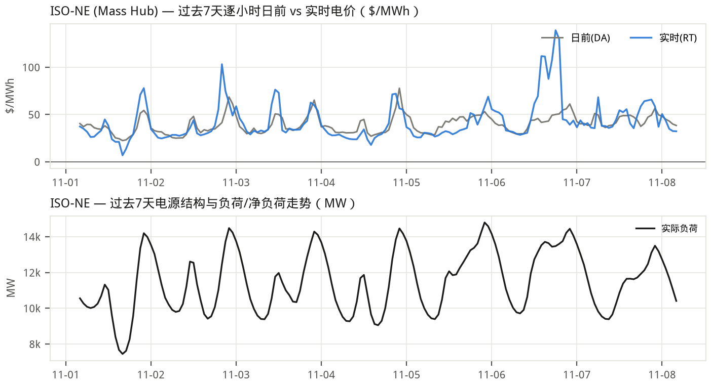

### SPP（西南电力联营）

- **主力枢纽 (North)**：本周 RT 均价 **21.10 $/MWh**（环比 -43.9%），峰值 **81.01**（2026-11-04 HE18），谷值 **-26.89**（2026-11-02 HE1）。
- **负荷与预测**：本周日均负荷 **33513 MW**（最高 **38642 MW**），周环比 **+4.8%**；负荷预测平均偏差 **+10 MW**（+0.0%）。
- **辅助服务周均价（$/MW·h）**：上调频 DA 13.50；下调频 DA 6.47；旋转/同步备用 DA 7.38；Ramp_Dn DA 0.01。

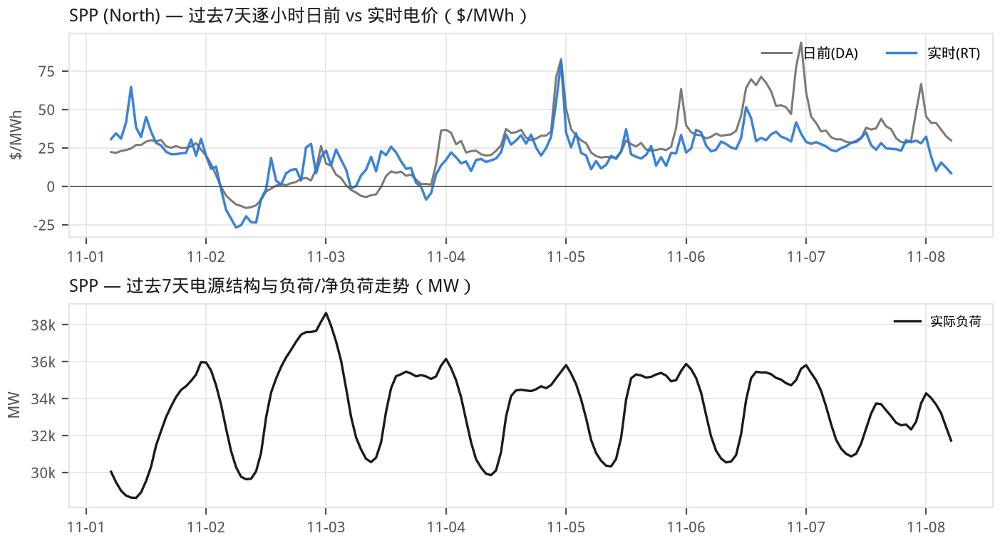

