# 美国七大电力市场（ISO/RTO）运行周报（2026-11-12 至 2026-11-18）

> **报告生成日（北京时间）**：2026-11-20 | **完整复盘周（美国运行日）**：`2026-11-12`（周日）至 `2026-11-18`（周六） | **环比基期**：`2026-11-05` 至 `2026-11-11`
> *注：周一北京时间下午生成时，美国周六已完成全天 RT 结算；峰时（On-Peak）统一按当地 HE8–23 口径测算。*

## 一、 本周全美电力市场核心摘要

- **价格格局**：本周全美最高 RT 均价出现在 **PJM**（120.1 $/MWh），最低为 **SPP**（25.8 $/MWh）。
- **最大波动区**：**ERCOT** 实时均价环比变动 **-38.8%**。
- **负电价频次**：本周出现实时负电价的地区包括 CAISO(3h)、ERCOT(3h)、SPP(9h)。

## 二、 跨区周度核心指标总览

| ISO (主枢纽) | 本周RT均价 ($/MWh) | RT周环比 | 本周DA均价 | Peak / Off-Peak (RT) | DART (DA-RT) | 负电价小时 | 周均负荷 (GW) | 负荷环比 | 负荷预测偏差 | 新能源占比 |
| :--- | :---: | :---: | :---: | :---: | :---: | :---: | :---: | :---: | :---: | :---: |
| **CAISO** (SP15) | 35.8 | -6.6% | 34.5 | 32.8 / 41.9 | -1.4 | 3 | 22.4 | +1.1% | +0.4% | 38.8% |
| **ERCOT** (North) | 28.2 | -38.8% | 33.1 | 27.2 / 30.2 | +4.9 | 3 | 49.5 | -0.7% | +0.2% | — |
| **PJM** (Western) | 120.1 | +20.3% | 115.3 | 122.6 / 115.2 | -4.8 | 0 | 92.4 | +7.3% | +0.1% | 7.1% |
| **MISO** (Indiana) | 39.6 | -3.7% | 42.1 | 40.6 / 37.5 | +2.6 | 0 | 73.5 | +4.1% | -0.2% | — |
| **NYISO** (Zone J(NYC)) | 49.6 | +35.4% | 47.8 | 53.4 / 42.0 | -1.8 | 0 | 15.9 | +5.2% | +2.1% | 7.6% |
| **ISO-NE** (Mass Hub) | 54.2 | +19.6% | 55.4 | 55.9 / 50.9 | +1.3 | 0 | 12.3 | +5.1% | -0.3% | 17.2% |
| **SPP** (North) | 25.8 | -21.8% | 28.3 | 25.5 / 26.4 | +2.6 | 9 | 35.0 | +4.9% | -0.1% | 47.1% |

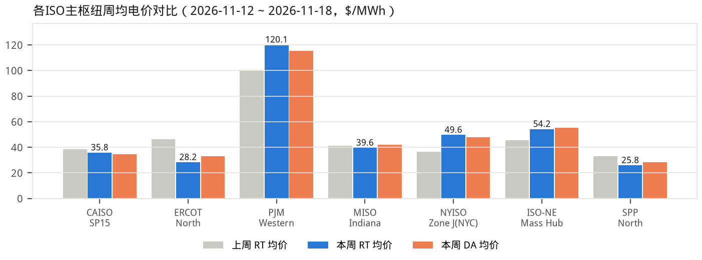
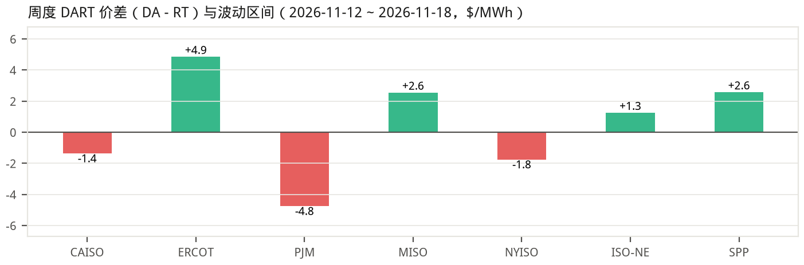
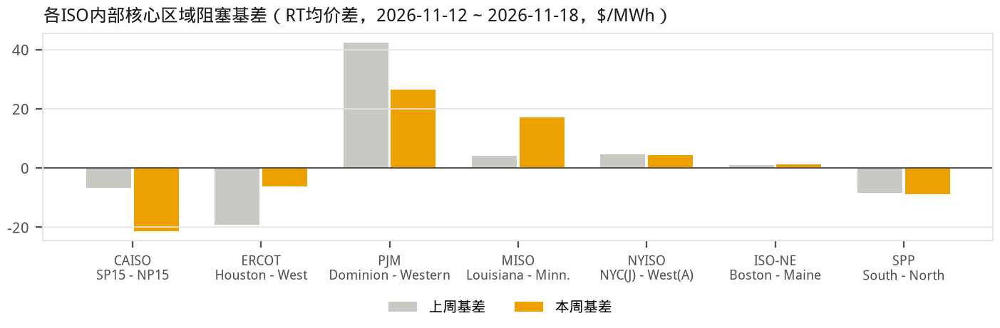
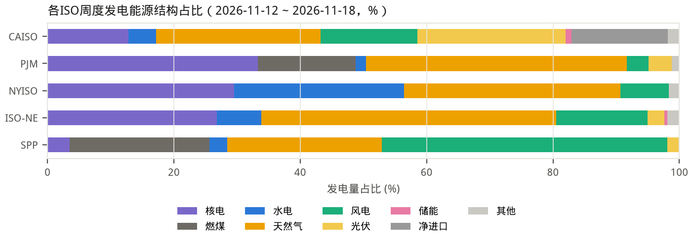

## 三、 空间阻塞基差与燃料基准

| ISO | 监测基差对 | 本周均价差 ($/MWh) | 上周均价差 | 周变化 ($/MWh) | 解读 |
| :--- | :--- | :---: | :---: | :---: | :--- |
| **CAISO** | SP15 - NP15 | -21.33 | -6.72 | -14.61 | 阻塞显著扩大 |
| **ERCOT** | Houston - West | -6.27 | -19.10 | +12.83 | 阻塞显著扩大 |
| **PJM** | Dominion - Western | +26.51 | +42.34 | -15.83 | 阻塞显著扩大 |
| **MISO** | Louisiana - Minn. | +17.08 | +4.14 | +12.94 | 阻塞显著扩大 |
| **NYISO** | NYC(J) - West(A) | +4.34 | +4.69 | -0.35 | 基差平稳 |
| **ISO-NE** | Boston - Maine | +1.21 | +0.90 | +0.31 | 基差平稳 |
| **SPP** | South - North | -8.95 | -8.41 | -0.54 | 基差平稳 |

### 天然气参考价格周均值（$/MMBtu）

| 气价枢纽 | 本周均值 | 上周均值 | 周环比 |
| :--- | :---: | :---: | :---: |
| **CAISO_ALL_MEDIAN** | 2.930 | — | — |

## 四、 周初开盘前瞻（周日 & 周一日前市场 DA）

| ISO (主枢纽) | 周日 DA 均价 | 周一 DA 均价 | 周一 vs 上周DA均值 | 周一预测峰值负荷 (GW) |
| :--- | :---: | :---: | :---: | :---: |
| **CAISO** (SP15) | 37.9 | 20.5 | -40.4% | 27.5 |
| **ERCOT** (North) | 25.1 | 14.3 | -56.7% | 54.0 |
| **PJM** (Western) | 85.5 | 74.7 | -35.3% | 99.9 |
| **MISO** (Indiana) | 34.9 | 39.9 | -5.2% | 77.0 |
| **NYISO** (Zone J(NYC)) | 41.1 | 41.0 | -14.3% | 17.3 |
| **ISO-NE** (Mass Hub) | 45.0 | 44.2 | -20.1% | 14.3 |
| **SPP** (North) | 32.4 | 6.1 | -78.6% | 36.1 |

## 五、 七大 ISO 分区详述（168小时走势）

### CAISO（加州独立系统运营商）

- **主力枢纽 (SP15)**：本周 RT 均价 **35.82 $/MWh**（环比 -6.6%），峰值 **67.58**（2026-11-16 HE20），谷值 **-3.62**（2026-11-17 HE14）。
- **负荷与预测**：本周日均负荷 **22448 MW**（最高 **28344 MW**），周环比 **+1.1%**；负荷预测平均偏差 **+83 MW**（+0.4%）。
- **发电结构与净负荷**：主力电源为 天然气 26.0%、光伏 23.5%、净进口 15.3%；风光合计占比 **38.8%**，周内最大3小时净负荷爬坡 **17939 MW**。
- **辅助服务周均价（$/MW·h）**：上调频 DA 2.66；下调频 DA 3.07；旋转/同步备用 DA 0.67；非旋转备用 DA 0.67。

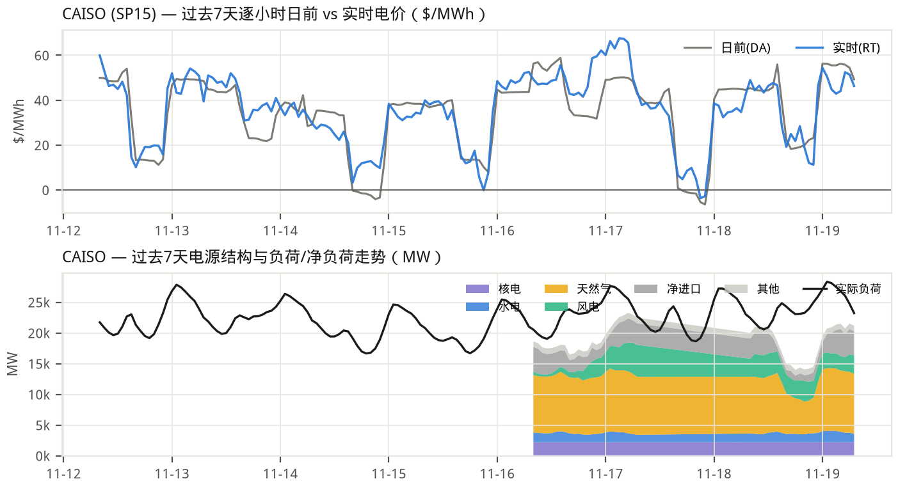

### ERCOT（德州电力可靠性委员会）

- **主力枢纽 (North)**：本周 RT 均价 **28.22 $/MWh**（环比 -38.8%），峰值 **103.98**（2026-11-12 HE19），谷值 **-1.22**（2026-11-18 HE11）。
- **负荷与预测**：本周日均负荷 **49463 MW**（最高 **56235 MW**），周环比 **-0.7%**；负荷预测平均偏差 **+109 MW**（+0.2%）。
- **辅助服务周均价（$/MW·h）**：上调频 DA 1.40；下调频 DA 1.08；响应备用(RRS) DA 0.52；紧急备用(ECRS) DA 0.76。

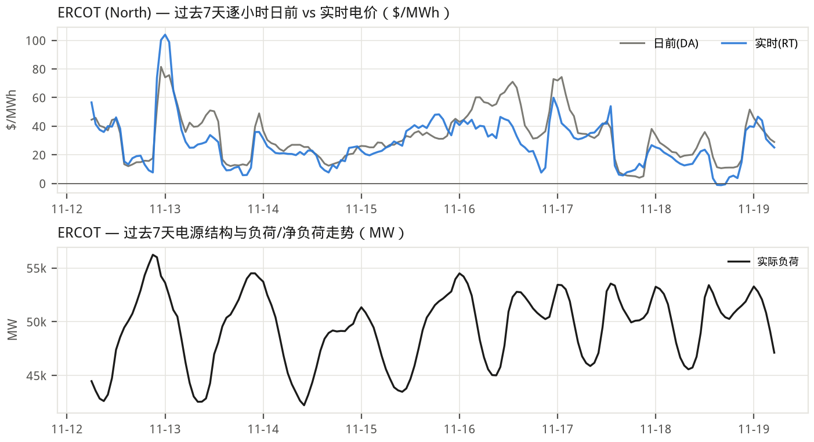

### PJM（PJM 互联）

- **主力枢纽 (Western)**：本周 RT 均价 **120.11 $/MWh**（环比 +20.3%），峰值 **1496.90**（2026-11-17 HE8），谷值 **23.06**（2026-11-16 HE14）。
- **负荷与预测**：本周日均负荷 **92423 MW**（最高 **106595 MW**），周环比 **+7.3%**；负荷预测平均偏差 **+83 MW**（+0.1%）。
- **发电结构与净负荷**：主力电源为 天然气 41.3%、核电 33.3%、燃煤 15.5%；风光合计占比 **7.1%**，周内最大3小时净负荷爬坡 **20346 MW**。
- **辅助服务周均价（$/MW·h）**：旋转/同步备用 DA 2.66；30分钟备用 DA 0.00；Primary Reserve DA 2.28。

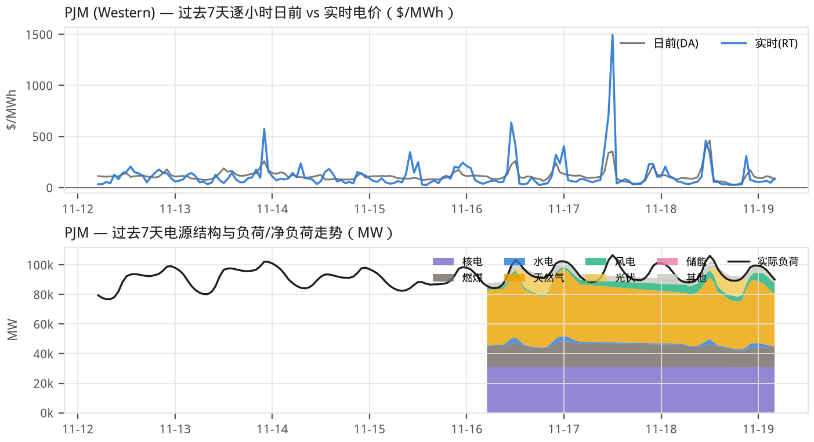

### MISO（中部大陆独立系统运营商）

- **主力枢纽 (Indiana)**：本周 RT 均价 **39.56 $/MWh**（环比 -3.7%），峰值 **178.30**（2026-11-12 HE8），谷值 **10.96**（2026-11-17 HE15）。
- **负荷与预测**：本周日均负荷 **73462 MW**（最高 **82131 MW**），周环比 **+4.1%**；负荷预测平均偏差 **-137 MW**（-0.2%）。
- **辅助服务周均价（$/MW·h）**：调频 DA 19.84；旋转/同步备用 DA 2.61；Supplemental Reserve DA 0.89。

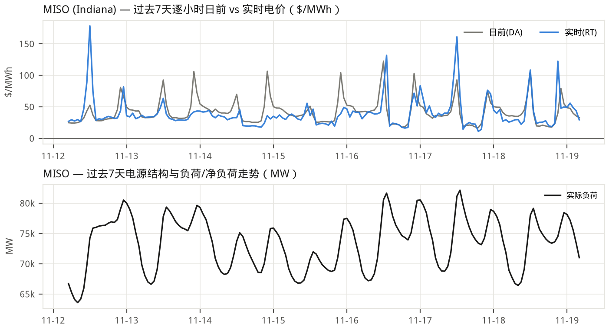

### NYISO（纽约独立系统运营商）

- **主力枢纽 (Zone J(NYC))**：本周 RT 均价 **49.58 $/MWh**（环比 +35.4%），峰值 **164.77**（2026-11-16 HE8），谷值 **30.82**（2026-11-12 HE4）。
- **负荷与预测**：本周日均负荷 **15875 MW**（最高 **18937 MW**），周环比 **+5.2%**；负荷预测平均偏差 **+327 MW**（+2.1%）。
- **发电结构与净负荷**：主力电源为 天然气 34.3%、核电 29.5%、水电 26.9%；风光合计占比 **7.6%**，周内最大3小时净负荷爬坡 **3731 MW**。
- **辅助服务周均价（$/MW·h）**：调频 DA 14.01；旋转/同步备用 DA 9.15；非旋转备用 DA 9.11；30分钟备用 DA 9.06。

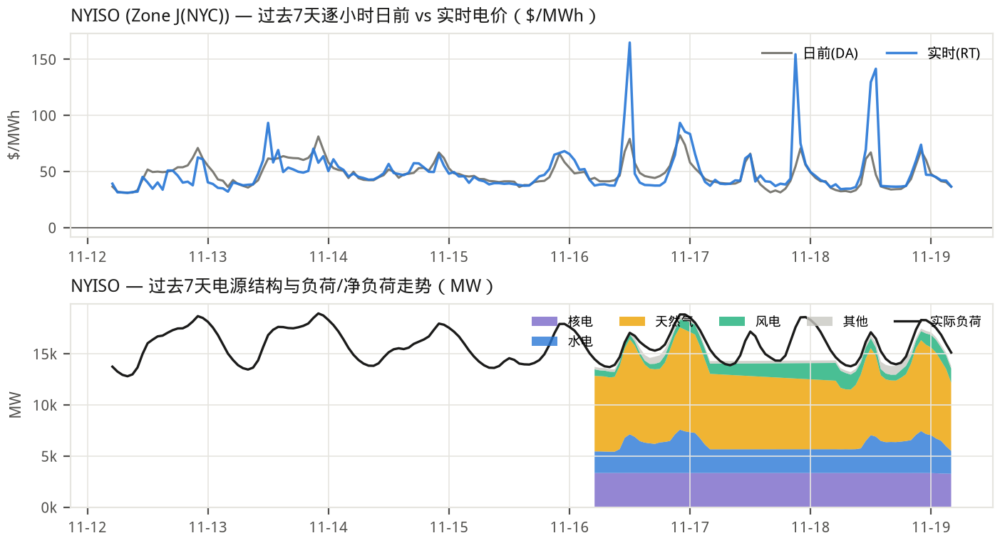

### ISO-NE（新英格兰独立系统运营商）

- **主力枢纽 (Mass Hub)**：本周 RT 均价 **54.18 $/MWh**（环比 +19.6%），峰值 **120.07**（2026-11-18 HE8），谷值 **28.29**（2026-11-12 HE24）。
- **负荷与预测**：本周日均负荷 **12343 MW**（最高 **15262 MW**），周环比 **+5.1%**；负荷预测平均偏差 **-34 MW**（-0.3%）。
- **发电结构与净负荷**：主力电源为 天然气 46.7%、核电 26.8%、风电 14.5%；风光合计占比 **17.2%**，周内最大3小时净负荷爬坡 **4875 MW**。
- **辅助服务周均价（$/MW·h）**：旋转/同步备用 DA — / RT 0.29；10分钟备用(TMR) DA — / RT 0.00；Total Reserve Clearing Price DA — / RT 0.00。

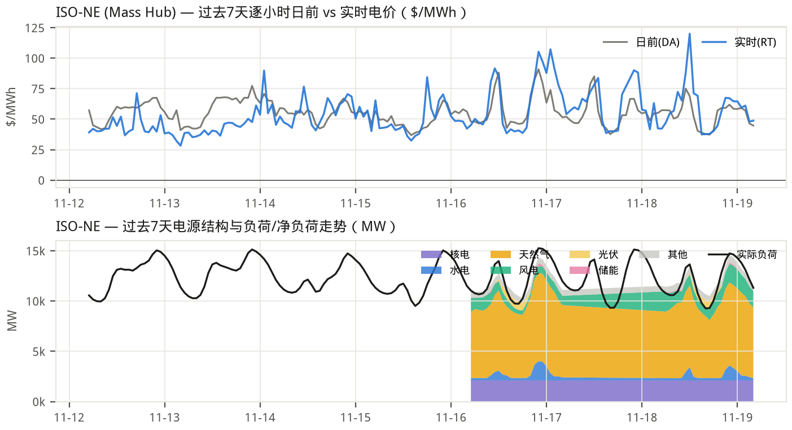

### SPP（西南电力联营）

- **主力枢纽 (North)**：本周 RT 均价 **25.82 $/MWh**（环比 -21.8%），峰值 **72.51**（2026-11-15 HE18），谷值 **-9.98**（2026-11-18 HE13）。
- **负荷与预测**：本周日均负荷 **34993 MW**（最高 **38337 MW**），周环比 **+4.9%**；负荷预测平均偏差 **-27 MW**（-0.1%）。
- **发电结构与净负荷**：主力电源为 风电 45.2%、天然气 24.5%、燃煤 22.1%；风光合计占比 **47.1%**，周内最大3小时净负荷爬坡 **17456 MW**。
- **辅助服务周均价（$/MW·h）**：上调频 DA 14.16；下调频 DA 7.64；旋转/同步备用 DA 7.35；Ramp_Dn DA 0.00。

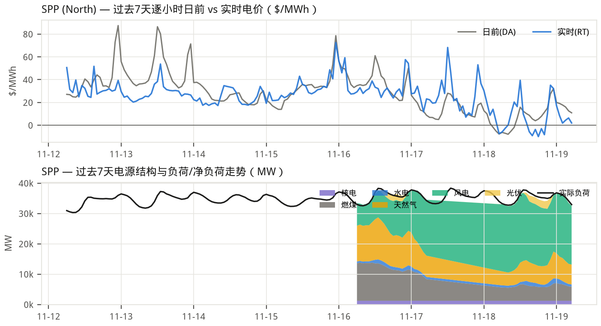

