# 美国七大电力市场（ISO/RTO）运行周报（2026-11-16 至 2026-11-22）

> **报告生成日（北京时间）**：2026-11-24 | **完整复盘周（美国运行日）**：`2026-11-16`（周日）至 `2026-11-22`（周六） | **环比基期**：`2026-11-09` 至 `2026-11-15`
> *注：周一北京时间下午生成时，美国周六已完成全天 RT 结算；峰时（On-Peak）统一按当地 HE8–23 口径测算。*

## 一、 本周全美电力市场核心摘要

- **价格格局**：本周全美最高 RT 均价出现在 **PJM**（106.5 $/MWh），最低为 **SPP**（16.2 $/MWh）。
- **最大波动区**：**SPP** 实时均价环比变动 **-52.7%**。
- **负电价频次**：本周出现实时负电价的地区包括 CAISO(17h)、ERCOT(3h)、SPP(25h)。
- **DART 系统性偏差**：本周日均 |DA-RT| ≥ 5 $/MWh 的市场：PJM(-11.7)、NYISO(-7.9)。

## 二、 跨区周度核心指标总览

| ISO (主枢纽) | 本周RT均价 ($/MWh) | RT周环比 | 本周DA均价 | Peak / Off-Peak (RT) | DART (DA-RT) | 负电价小时 | 周均负荷 (GW) | 负荷环比 | 负荷预测偏差 | 新能源占比 |
| :--- | :---: | :---: | :---: | :---: | :---: | :---: | :---: | :---: | :---: | :---: |
| **CAISO** (SP15) | 32.1 | -7.7% | 34.2 | 28.0 / 40.4 | +1.7 | 17 | 23.3 | +5.1% | +0.3% | 46.5% |
| **ERCOT** (North) | 24.2 | -40.5% | 25.5 | 23.1 / 26.4 | +2.3 | 3 | 50.0 | +1.9% | +0.1% | 44.7% |
| **PJM** (Western) | 106.5 | -12.8% | 87.8 | 102.5 / 114.5 | -11.7 | 0 | 92.2 | +3.0% | +0.5% | 8.1% |
| **MISO** (Indiana) | 40.8 | -4.3% | 36.6 | 41.7 / 38.9 | -2.8 | 0 | 72.5 | +0.2% | -0.8% | — |
| **NYISO** (Zone J(NYC)) | 51.1 | +15.9% | 42.2 | 56.2 / 40.8 | -7.9 | 0 | 15.5 | -0.9% | +2.8% | 7.8% |
| **ISO-NE** (Mass Hub) | 53.9 | +14.2% | 49.1 | 55.5 / 50.6 | -3.7 | 0 | 11.8 | -3.0% | +0.2% | 15.1% |
| **SPP** (North) | 16.2 | -52.7% | 16.5 | 17.8 / 13.1 | +0.6 | 25 | 34.8 | +1.9% | +0.6% | 55.0% |

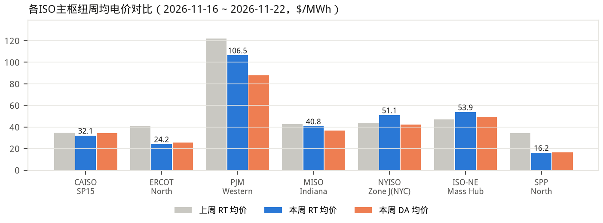
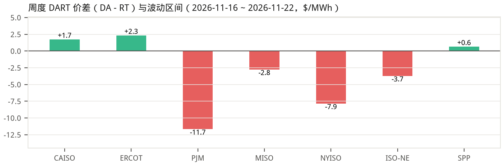
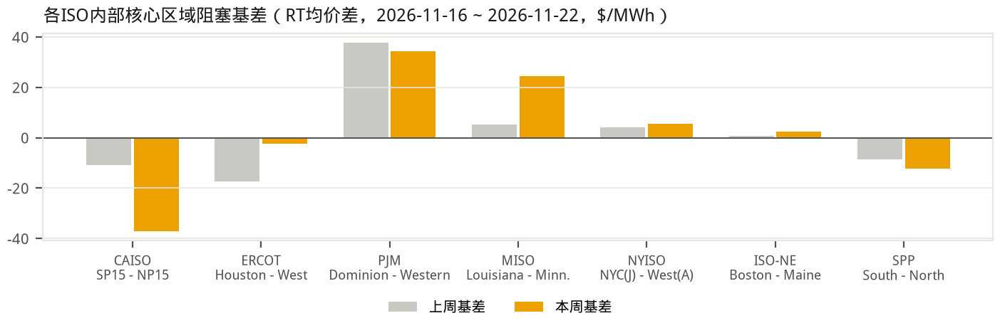
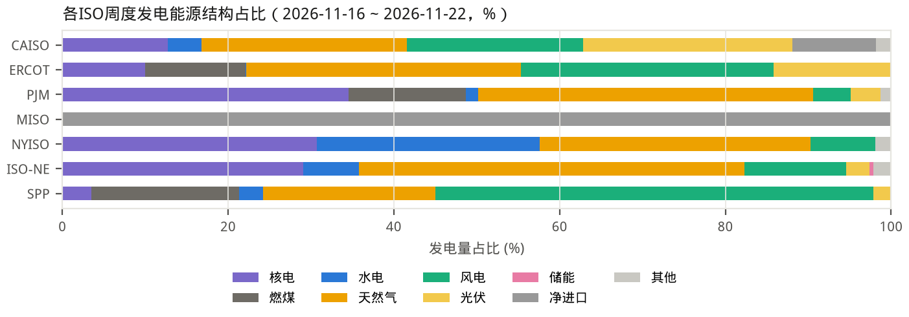

## 三、 空间阻塞基差与燃料基准

| ISO | 监测基差对 | 本周均价差 ($/MWh) | 上周均价差 | 周变化 ($/MWh) | 解读 |
| :--- | :--- | :---: | :---: | :---: | :--- |
| **CAISO** | SP15 - NP15 | -37.12 | -10.75 | -26.37 | 阻塞显著扩大 |
| **ERCOT** | Houston - West | -2.26 | -17.44 | +15.18 | 阻塞显著扩大 |
| **PJM** | Dominion - Western | +34.39 | +37.74 | -3.35 | 基差平稳 |
| **MISO** | Louisiana - Minn. | +24.52 | +5.15 | +19.37 | 阻塞显著扩大 |
| **NYISO** | NYC(J) - West(A) | +5.48 | +4.02 | +1.46 | 基差平稳 |
| **ISO-NE** | Boston - Maine | +2.45 | +0.68 | +1.77 | 基差平稳 |
| **SPP** | South - North | -12.16 | -8.49 | -3.67 | 基差平稳 |

### 天然气参考价格周均值（$/MMBtu）

| 气价枢纽 | 本周均值 | 上周均值 | 周环比 |
| :--- | :---: | :---: | :---: |
| **CAISO_ALL_MEDIAN** | 2.986 | — | — |

## 四、 周初开盘前瞻（周日 & 周一日前市场 DA）

| ISO (主枢纽) | 周日 DA 均价 | 周一 DA 均价 | 周一 vs 上周DA均值 | 周一预测峰值负荷 (GW) |
| :--- | :---: | :---: | :---: | :---: |
| **CAISO** (SP15) | 40.9 | — | — | — |
| **ERCOT** (North) | 28.1 | — | — | — |
| **PJM** (Western) | 56.3 | — | — | — |
| **MISO** (Indiana) | 41.7 | — | — | — |
| **NYISO** (Zone J(NYC)) | 40.2 | — | — | — |
| **ISO-NE** (Mass Hub) | 41.6 | — | — | — |
| **SPP** (North) | 41.8 | — | — | — |

## 五、 七大 ISO 分区详述（168小时走势）

### CAISO（加州独立系统运营商）

- **主力枢纽 (SP15)**：本周 RT 均价 **32.15 $/MWh**（环比 -7.7%），峰值 **67.58**（2026-11-16 HE20），谷值 **-17.49**（2026-11-20 HE15）。
- **负荷与预测**：本周日均负荷 **23339 MW**（最高 **28344 MW**），周环比 **+5.1%**；负荷预测平均偏差 **+70 MW**（+0.3%）。
- **发电结构与净负荷**：主力电源为 光伏 25.3%、天然气 24.8%、风电 21.2%；风光合计占比 **46.5%**，周内最大3小时净负荷爬坡 **19886 MW**。
- **辅助服务周均价（$/MW·h）**：上调频 DA 2.69；下调频 DA 3.23；旋转/同步备用 DA 0.71；非旋转备用 DA 0.71。

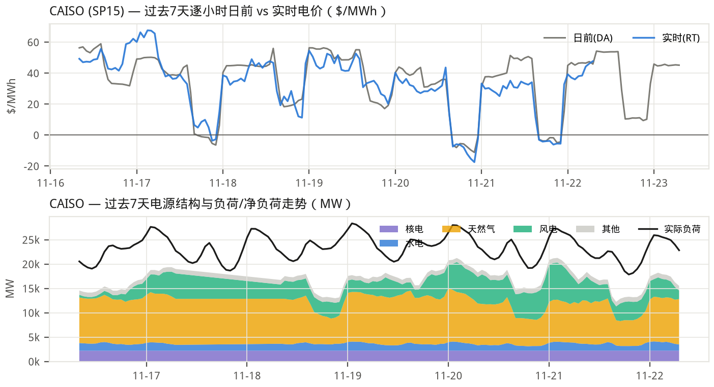

### ERCOT（德州电力可靠性委员会）

- **主力枢纽 (North)**：本周 RT 均价 **24.20 $/MWh**（环比 -40.5%），峰值 **59.93**（2026-11-16 HE18），谷值 **-1.22**（2026-11-18 HE11）。
- **负荷与预测**：本周日均负荷 **50007 MW**（最高 **54355 MW**），周环比 **+1.9%**；负荷预测平均偏差 **+53 MW**（+0.1%）。
- **发电结构与净负荷**：主力电源为 天然气 33.1%、风电 30.5%、光伏 14.2%；风光合计占比 **44.7%**，周内最大3小时净负荷爬坡 **23344 MW**。
- **辅助服务周均价（$/MW·h）**：上调频 DA 1.12；下调频 DA 0.85；响应备用(RRS) DA 0.39；紧急备用(ECRS) DA 0.55。

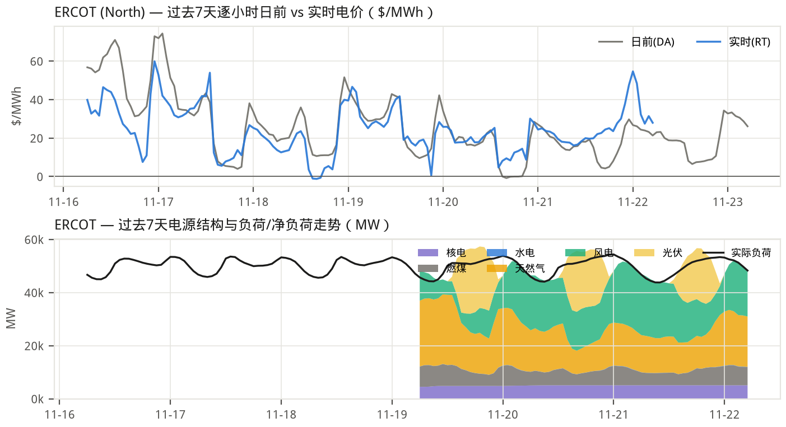

### PJM（PJM 互联）

- **主力枢纽 (Western)**：本周 RT 均价 **106.53 $/MWh**（环比 -12.8%），峰值 **1496.90**（2026-11-17 HE8），谷值 **18.67**（2026-11-21 HE10）。
- **负荷与预测**：本周日均负荷 **92174 MW**（最高 **106595 MW**），周环比 **+3.0%**；负荷预测平均偏差 **+467 MW**（+0.5%）。
- **发电结构与净负荷**：主力电源为 天然气 40.4%、核电 34.5%、燃煤 14.2%；风光合计占比 **8.1%**，周内最大3小时净负荷爬坡 **20346 MW**。
- **辅助服务周均价（$/MW·h）**：旋转/同步备用 DA 3.80；30分钟备用 DA 0.00；Primary Reserve DA 2.96。

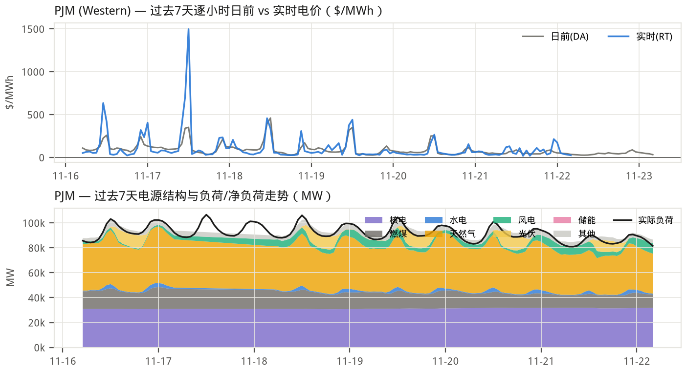

### MISO（中部大陆独立系统运营商）

- **主力枢纽 (Indiana)**：本周 RT 均价 **40.80 $/MWh**（环比 -4.3%），峰值 **264.26**（2026-11-19 HE8），谷值 **6.49**（2026-11-21 HE15）。
- **负荷与预测**：本周日均负荷 **72489 MW**（最高 **82131 MW**），周环比 **+0.2%**；负荷预测平均偏差 **-611 MW**（-0.8%）。
- **发电结构与净负荷**：主力电源为 净进口 100.0%；风光合计占比 **—**，周内最大3小时净负荷爬坡 **12242 MW**。
- **辅助服务周均价（$/MW·h）**：调频 DA 22.04；旋转/同步备用 DA 2.10；Supplemental Reserve DA 0.38。

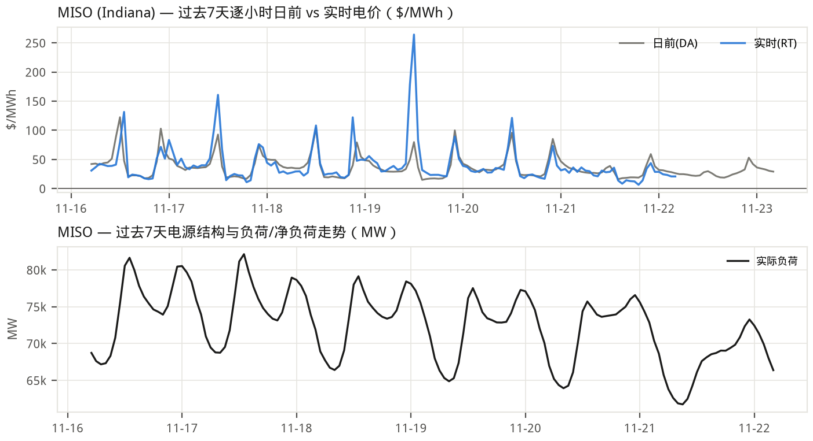

### NYISO（纽约独立系统运营商）

- **主力枢纽 (Zone J(NYC))**：本周 RT 均价 **51.06 $/MWh**（环比 +15.9%），峰值 **324.55**（2026-11-20 HE9），谷值 **16.06**（2026-11-19 HE7）。
- **负荷与预测**：本周日均负荷 **15470 MW**（最高 **18836 MW**），周环比 **-0.9%**；负荷预测平均偏差 **+419 MW**（+2.8%）。
- **发电结构与净负荷**：主力电源为 天然气 32.7%、核电 30.7%、水电 26.9%；风光合计占比 **7.8%**，周内最大3小时净负荷爬坡 **3731 MW**。
- **辅助服务周均价（$/MW·h）**：调频 DA 15.92；旋转/同步备用 DA 7.72；非旋转备用 DA 7.70；30分钟备用 DA 7.65。

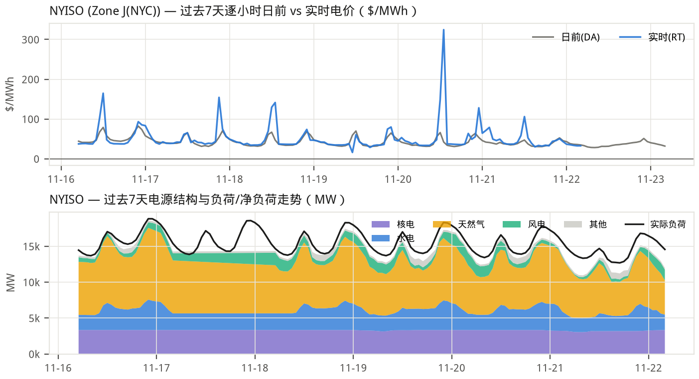

### ISO-NE（新英格兰独立系统运营商）

- **主力枢纽 (Mass Hub)**：本周 RT 均价 **53.85 $/MWh**（环比 +14.2%），峰值 **120.07**（2026-11-18 HE8），谷值 **30.17**（2026-11-21 HE24）。
- **负荷与预测**：本周日均负荷 **11826 MW**（最高 **15262 MW**），周环比 **-3.0%**；负荷预测平均偏差 **+25 MW**（+0.2%）。
- **发电结构与净负荷**：主力电源为 天然气 46.5%、核电 29.1%、风电 12.3%；风光合计占比 **15.1%**，周内最大3小时净负荷爬坡 **4875 MW**。
- **辅助服务周均价（$/MW·h）**：旋转/同步备用 DA — / RT 0.39；10分钟备用(TMR) DA — / RT 0.00；Total Reserve Clearing Price DA — / RT 0.00。

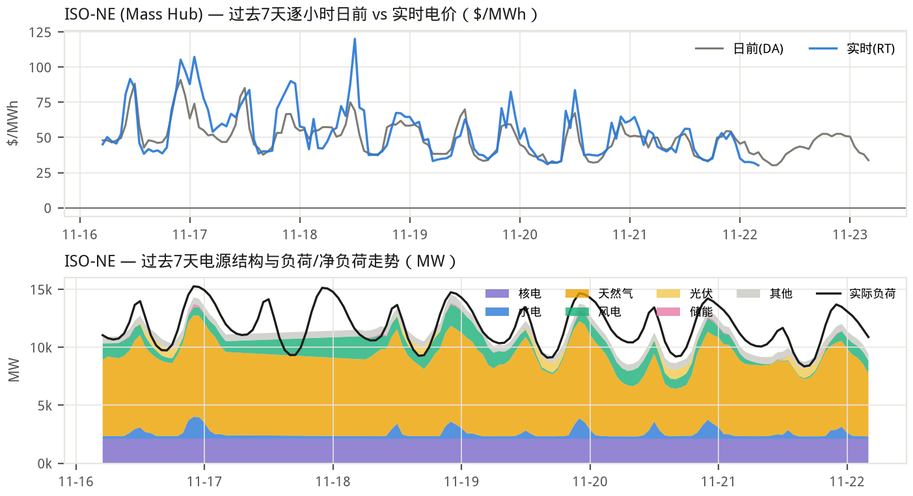

### SPP（西南电力联营）

- **主力枢纽 (North)**：本周 RT 均价 **16.25 $/MWh**（环比 -52.7%），峰值 **68.39**（2026-11-19 HE10），谷值 **-28.21**（2026-11-20 HE1）。
- **负荷与预测**：本周日均负荷 **34832 MW**（最高 **38337 MW**），周环比 **+1.9%**；负荷预测平均偏差 **+207 MW**（+0.6%）。
- **发电结构与净负荷**：主力电源为 风电 52.9%、天然气 20.8%、燃煤 17.8%；风光合计占比 **55.0%**，周内最大3小时净负荷爬坡 **17456 MW**。
- **辅助服务周均价（$/MW·h）**：上调频 DA 14.42；下调频 DA 9.10；旋转/同步备用 DA 5.91；Ramp_Dn DA 0.00。

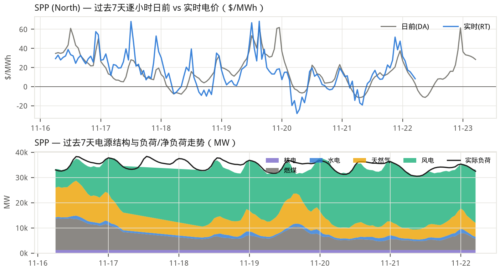

